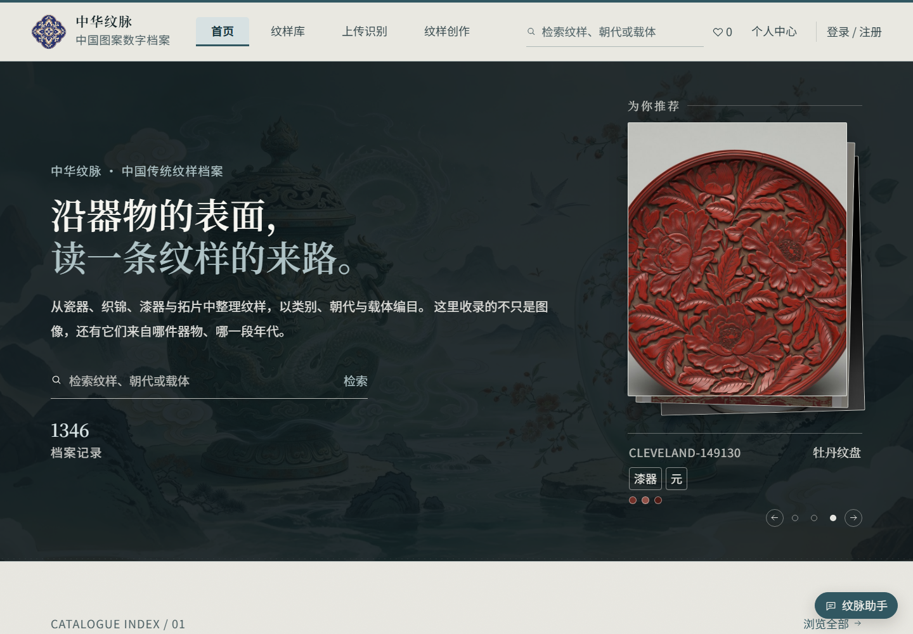
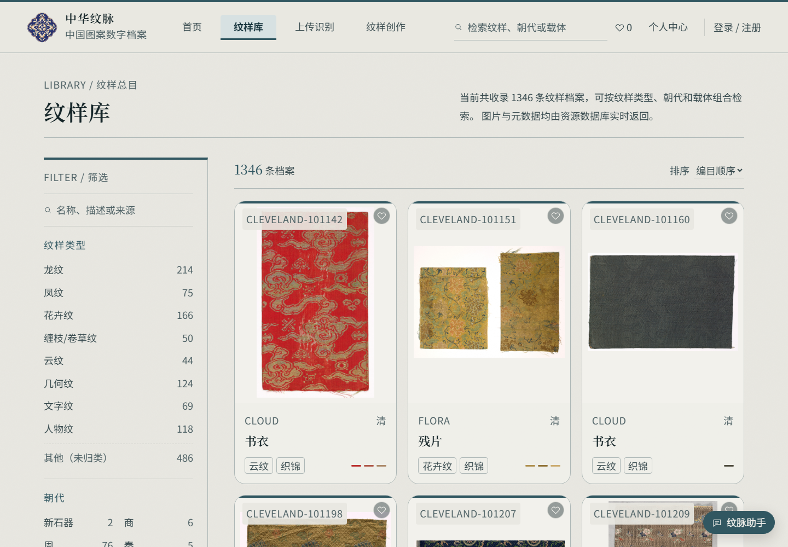

# 中华纹脉 · 中国传统纹样与图案资源库

一个可直接运行的中国传统纹样数字档案系统，包含图录式首页、可筛选的资源库、纹样详情、上传识别、纹样创作、个人收藏与后台管理。

本仓库是**最小可用版本**：带 55 条已标注示例记录和对应本地图片，克隆后按下面的步骤即可在本地跑起来。




## 功能

- **首页**：为你推荐三图叠放、纹样总目、蛇形朝代时间轴、馆藏精选、最近整理
- **纹样库**：关键词搜索，按纹样类型 / 朝代 / 载体组合筛选，筛选计数联动，分页
- **详情页**：大图与多图、主色提取、收藏、来源链接、相关推荐；返回列表时恢复筛选和滚动位置
- **个人中心**：注册 / 登录、收藏、浏览记录
- **后台管理**：档案增删改查、用户管理、角色权限（仅管理员）
- **认证**：JWT + bcrypt，修改密码后旧令牌自动失效
- **图片**：本地图片通过后端 `/api/images/{id}` 提供，TIFF 会自动转 JPEG

## 技术栈

| 层 | 技术 |
|---|---|
| 前端 | Vue 3 + Vite + Pinia + Vue Router |
| 后端 | FastAPI + SQLAlchemy 2 + Pydantic |
| 数据库 | SQLite（默认），也支持 MySQL |
| 认证 | PyJWT + bcrypt |
| 测试 | pytest + httpx |

## 快速开始

需要：**Python 3.11+**、**Node.js 20+**。

### 1. 启动后端

```bash
cd backend
python -m venv .venv
```

Windows：

```powershell
.venv\Scripts\activate
```

macOS / Linux：

```bash
source .venv/bin/activate
```

安装依赖并启动：

```bash
pip install -r requirements.txt
uvicorn app.main:app --reload --port 8000
```

后端地址：http://127.0.0.1:8000  
API 文档：http://127.0.0.1:8000/docs

首次启动会自动创建管理员和演示账号，并生成：

- `data/admin-initial-password.txt`：管理员初始密码
- `data/.jwt_secret`：JWT 密钥（本地生成，不要提交）

管理员用户名固定为 `admin`，密码见上述文件。也可以首次启动前设置环境变量 `WENMAI_ADMIN_PASSWORD` 指定密码：

```powershell
$env:WENMAI_ADMIN_PASSWORD = "your-strong-password"
uvicorn app.main:app --reload --port 8000
```

### 2. 启动前端

另开一个终端：

```bash
cd frontend
npm install
npm run dev
```

打开 http://127.0.0.1:5173 。

Vite 开发服务器默认把 `/api` 代理到 `http://127.0.0.1:8000`，后端端口不变时无需额外配置。

## 账号

| 账号 | 用途 | 密码 |
|---|---|---|
| `admin` | 管理员 / 后台 | 首次启动生成，见 `data/admin-initial-password.txt` |
| `demo` | 游客兜底、普通用户 | 无密码，不能登录后台 |

普通用户可在登录页直接注册。

修改管理员密码：

```bash
cd backend
python -m app.admin_tool set-password --generate
```

## 常用命令

```bash
# 后端测试
cd backend
pip install -r requirements-dev.txt
pytest

# 前端生产构建
cd frontend
npm run build
```

## 数据说明

仓库自带 **55 条示例记录**，图片位于 `frontend/public/patterns/`，数据库为 `data/wenmai.db`。因此即使没有原始标注包，首页、纹样库、详情、筛选和后台也都可以正常使用。

完整资源库为 1346 条记录、1311 张图片，原始图片在 `annotation_packages/` 中，体积约 4GB，不适合直接放进 GitHub。需要完整数据时，可按 `data/README.md` 和 `backend/README.md` 的说明放回主数据与图片后重新导入，或直接用完整数据库替换 `data/wenmai.db`。

## 目录结构

```text
backend/          FastAPI 服务、数据模型、认证、测试
frontend/         Vue 3 前端
  public/patterns 示例图片
data/wenmai.db    55 条示例数据库
data/README.md    示例数据与完整数据说明
docs/screenshots  界面截图
tools/            数据整理、命名与浏览器检查脚本
```

## 图片与来源

示例图片来自 Cleveland Museum of Art、The Metropolitan Museum of Art、Wikimedia Commons、数字敦煌等公开馆藏，均为其标注的公有领域 / CC0 资源。具体来源与许可记录在数据库的 `source`、`source_url`、`license` 字段中。

## 说明

- 本仓库是可运行的课程 / 作品集版本，不包含生产环境部署配置。
- 如果用于公网部署，请务必修改管理员密码、设置强随机 `WENMAI_JWT_SECRET`，并把 SQLite 换成 MySQL 或 PostgreSQL。
- 后台地址：http://127.0.0.1:5173/admin
